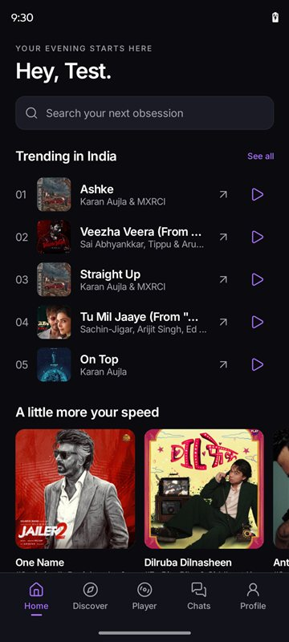
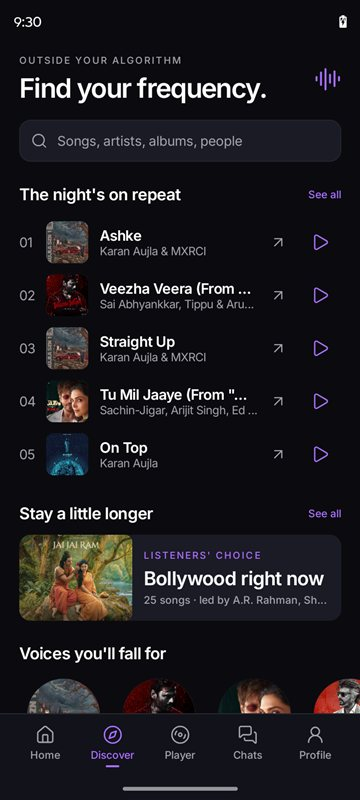
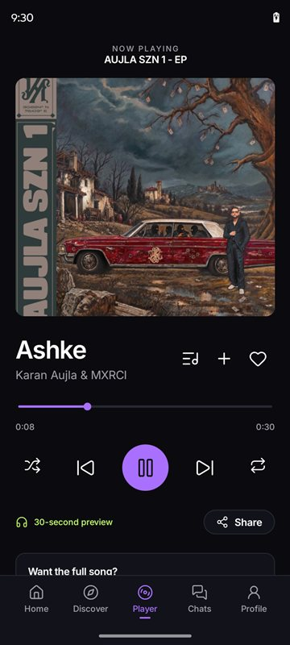
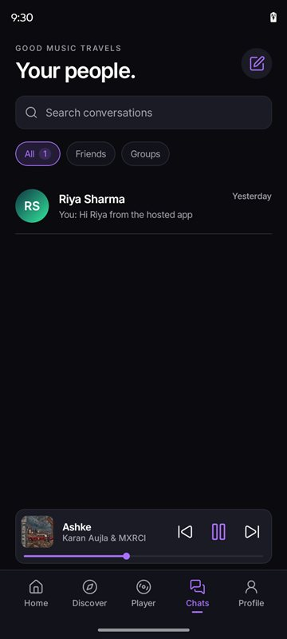
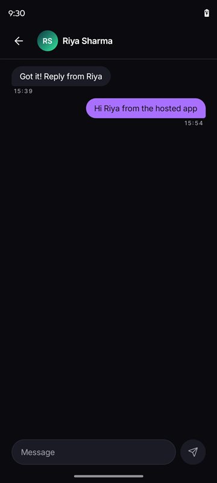
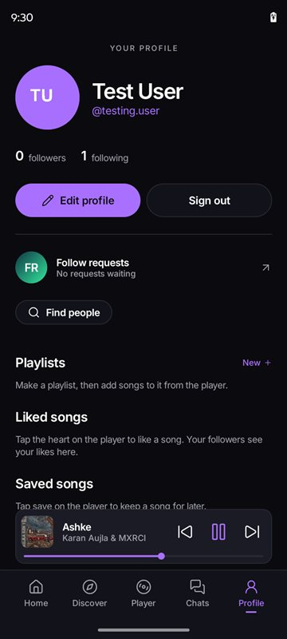

# Butter

A music-first social app for Android: listen, follow friends, swap songs in chat and find new music together.
Built with Kotlin, Jetpack Compose and Supabase. Visual language: **Afterglow** (dark, violet for action, lime for presence).

> Status: **Phase 4 done, in testing.** A signed test build (`v0.1.0`) runs against a hosted Supabase project and is being
> shared with testers. Push notifications are next. See [docs/IMPLEMENTATION_STATUS.md](docs/IMPLEMENTATION_STATUS.md)
> for exactly what works and what was verified on a device.

## Screenshots

| Home | Discover | Player |
|:---:|:---:|:---:|
|  |  |  |
| **Chats** | **Conversation** | **Profile** |
|  |  |  |

Captured on a moto g34 (Android 15) with the release build and test accounts. Album art and 30-second previews come from
iTunes; songs open in Apple Music.

## Features

- **Music:** Apple Music's India charts, Bollywood chart, artist pages and song search (iTunes Search API). 30-second
  previews with a full player, mini player, queue, shuffle and repeat. Playback continues in the background with
  lock-screen and notification controls.
- **Library:** like and save songs, and create playlists. Approved followers can see them.
- **People:** search, profiles, follow requests that need approval, followers/following lists, profile photos.
- **Chat:** real-time one-to-one and group chats. Share a song into a chat and play it from there.
- **Safety:** block and report people. Database rules (Row Level Security) decide who can see and send what; they are
  tested in `backend/supabase/tests/`.
- **Coming next:** push notifications, password reset, account deletion. Order and scope: [docs/ROADMAP.md](docs/ROADMAP.md).

## Technology

| Area | Choice |
|---|---|
| Language / UI | Kotlin 2.4, Jetpack Compose, Material 3, Navigation Compose (type-safe routes) |
| Architecture | MVVM, Clean Architecture, repository pattern, multi-module Gradle |
| DI | Hilt (KSP) |
| Backend | Supabase (Postgres, Auth, Realtime, Storage) through the community `supabase-kt` client |
| Local data | Room (cache), Preferences DataStore (settings) |
| Networking | OkHttp (shared client), kotlinx.serialization. Retrofit is in the version catalog but unused until a non-Supabase REST API exists |
| Images / Playback | Coil 3 / AndroidX Media3 (ExoPlayer plus a `MediaSessionService` for background playback) |
| Music catalogue | iTunes Search API and Apple's chart feeds (India storefront); previews are streamed, never stored |
| Tests | JUnit 4, MockK, Turbine, Compose UI Test |
| Build | Gradle 9.8 (Kotlin DSL), AGP 9.5, version catalog, convention plugins in `build-logic/` |

## Prerequisites

- Android Studio (current stable) with Android SDK 37 and Build Tools 36
- JDK 17 or newer (Android Studio's bundled JDK works)
- An Android device or emulator on Android 8.0 (API 26) or newer
- Optional: a Supabase project, or the Supabase CLI + Docker for a local backend

## Build and run

```powershell
# 1. Create local config (git-ignored). Android Studio creates local.properties with sdk.dir automatically.
copy local.properties.example local.properties   # then edit; see "Backend configuration"

# 2. Build and install the dev flavour on a connected device
.\gradlew.bat installDevDebug

# 3. Launch (or tap the app icon)
adb shell am start -n com.yourcompany.musicsocial.dev.debug/com.yourcompany.musicsocial.MainActivity
```

In Android Studio: open this folder, choose the `devDebug` build variant, press Run.
The app runs **without any Supabase credentials**; it shows a "Backend not connected" notice instead of faking a connection.

## Backend configuration

1. Create a Supabase project (use a separate one for production).
2. Dashboard -> Project Settings -> API: copy the project URL and the **publishable / anon** key.
3. Put them in `local.properties`:
   ```properties
   SUPABASE_URL=https://YOUR-PROJECT-REF.supabase.co
   SUPABASE_ANON_KEY=YOUR-PUBLISHABLE-OR-ANON-KEY
   ```
   Production values use `PROD_SUPABASE_URL` / `PROD_SUPABASE_ANON_KEY`. In CI set the same names as environment variables.
4. Apply the database schema: see [backend/supabase/README.md](backend/supabase/README.md).

**Never** put a `service_role` / secret key in the app. The build fails if it detects one.

## Tests

```powershell
.\gradlew.bat testDevDebugUnitTest testDebugUnitTest :core:domain:test   # JVM unit tests (no device)
.\gradlew.bat :core:designsystem:connectedDebugAndroidTest :feature:profile:connectedDebugAndroidTest   # Compose UI tests (device/emulator)
```

## Architecture in one minute

`app` assembles the navigation shell and wires data modules. `feature:*` modules contain screens and ViewModels only and
depend on `core:*` and on repository **interfaces** in `core:domain`. `data:*` modules implement those interfaces against
Supabase and Room. UI code never touches Supabase or the database. Details: [docs/ARCHITECTURE.md](docs/ARCHITECTURE.md),
[docs/PROJECT_STRUCTURE.md](docs/PROJECT_STRUCTURE.md).

## Documentation

[Architecture](docs/ARCHITECTURE.md) · [Project structure](docs/PROJECT_STRUCTURE.md) · [Database design](docs/DATABASE_DESIGN.md) ·
[API design](docs/API_DESIGN.md) · [Development guide](docs/DEVELOPMENT_GUIDE.md) · [Coding standards](docs/CODING_STANDARDS.md) ·
[Roadmap](docs/ROADMAP.md) · [Implementation status](docs/IMPLEMENTATION_STATUS.md)

## Licences of bundled assets

Inter font (SIL OFL) and Lucide icons (ISC): see `docs/licenses/`.
